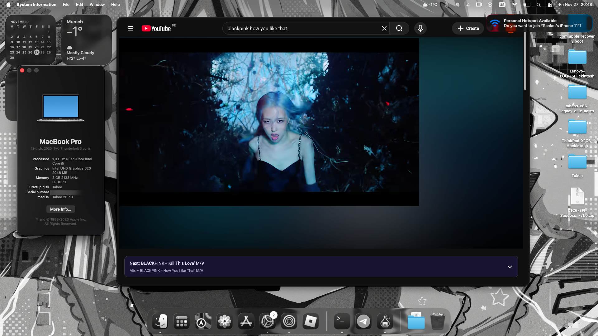
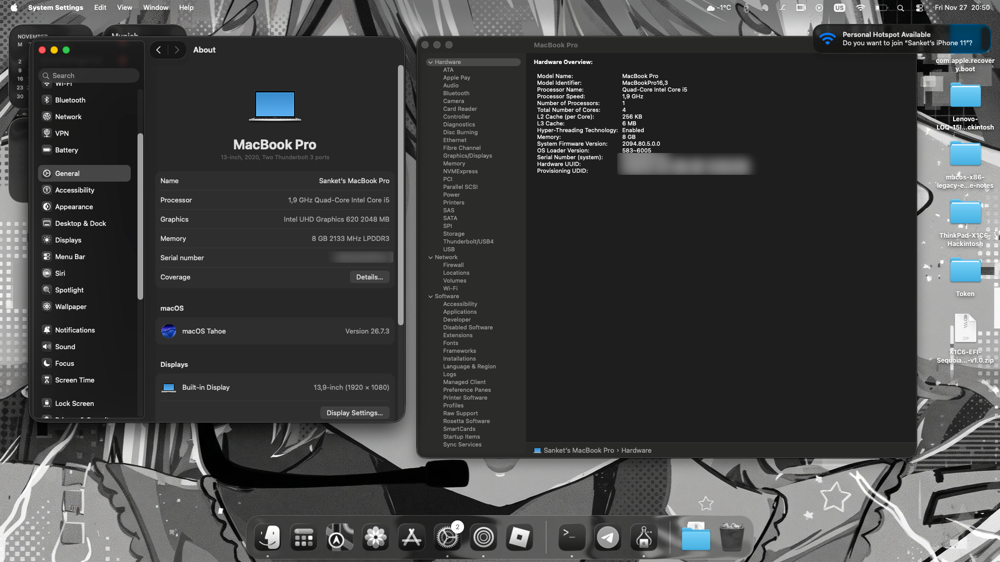
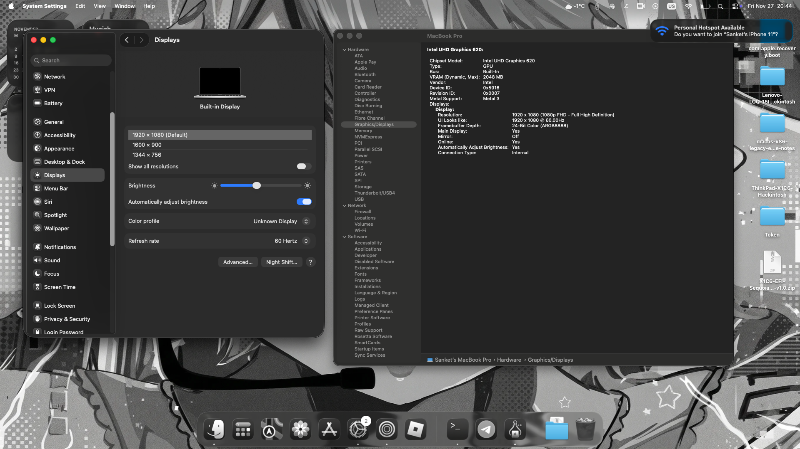
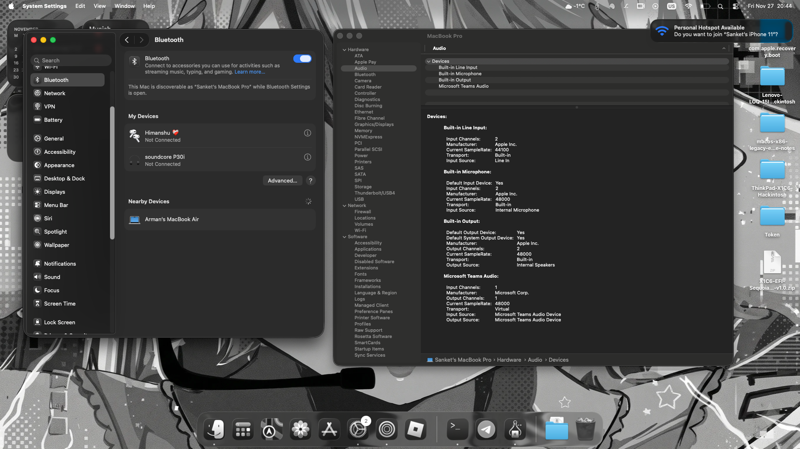
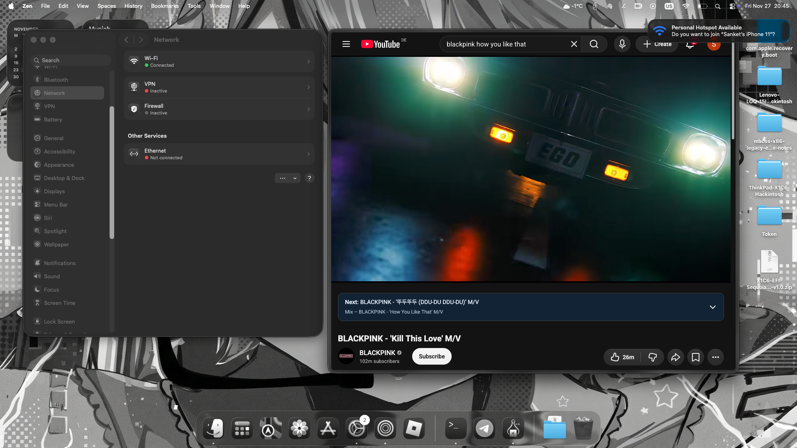

# ThinkPad X1 Carbon 6th Gen (20KG / 20KH) — macOS EFI

OpenCore EFI and post-install suite for the Lenovo ThinkPad X1 Carbon 6th Generation, tested as a daily driver up to **macOS Tahoe 26.7.3 (Build `25G342`)**.

| Folder | Target macOS Versions | OpenCore | SMBIOS | Status |
| :--- | :--- | :---: | :---: | :--- |
| [`EFI/`](./EFI) | **Ventura (13.x)**, **Sonoma (14.x)**, **Sequoia (15.x)** | 1.0.2 | `MacBookPro15,2` | Stable (`v1.0.5`) |
| [`EFI-Tahoe/`](./EFI-Tahoe) | **macOS Tahoe (26.x)** + Dual-Boot Sonoma / Sequoia | 1.0.8 | `MacBookPro16,3` | **Stable (`v2.0`)** |

> **Which folder should I use?**
> - Use **`EFI/`** if you only run **Ventura, Sonoma, or Sequoia** (keeps Thunderbolt 3 active and uses `MacBookPro15,2`).
> - Use **`EFI-Tahoe/`** if you run **macOS 26 Tahoe** (tested on `26.7.3`).
>
> **Important — Generate your own SMBIOS first:** `EFI-Tahoe/OC/config.plist` ships with placeholder values (`C02000000000`, zeroed `SystemUUID`, dummy `MLB`/`ROM`). Generate your own `MacBookPro16,3` SMBIOS with `Utilities/macserial` before copying to your EFI partition or signing into Apple Account / iMessage.

---

## Screenshots (macOS Tahoe 26.7.3)

| Desktop, About This Mac & YouTube (Zen Browser) | macOS Tahoe About & Hardware Overview |
| :---: | :---: |
|  |  |

| Intel UHD 620 (Metal 3, 2048 MB) & Display | Bluetooth & Internal Audio (Realtek ALC285) |
| :---: | :---: |
|  |  |

| Native macOS Wi-Fi (`ForbiddenItlwm`) & Dock |
| :---: |
|  |

---

## What Changed in `v2.0` (Tahoe Daily-Driver Fixes)

- **Native macOS Wi-Fi (`ForbiddenItlwm 0.7.0`):** Replaced `itlwm.kext` + `HeliPort.app` on Tahoe with `ForbiddenItlwm.kext` (`MinKernel = 25.0.0`, `MaxKernel = 25.99.99`). Wi-Fi now connects directly from **System Settings → Wi-Fi** and the macOS menu bar, no third-party tray app required. *(Uses `itlwm_lqmint=5` in `boot-args`; add `itlwm_cc=US` / `DE` / etc. if your region needs an explicit country code.)*
- **Bluetooth Kernel Panic Fixed (`2.5.3`):** Updated `IntelBluetoothFirmware.kext` and `IntelBTPatcher.kext` to **2.5.3** (with `BlueToolFixup 2.7.2` + `SSDT-XHC1.aml`), eliminating the `IOGMD: not wired for the IODMACommand` panic on Tahoe. Tested with Bluetooth audio (e.g. earbuds/headphones) across reboots and lid sleep.
- **Touch ID Support (`MetallicaIds.efi`):** Added `MetallicaIds.efi` in `EFI-Tahoe/OC/Drivers/` so the real ThinkPad `product_name` and serial are passed cleanly to `hack-touchid` for the Synaptics `06cb:009a` fingerprint sensor (login + wake from sleep).
- **Audio & Hotkeys:** `SimpleHDA.kext` (`1.0.2`, `shda-lang=en`) + `AppleALC.kext` (`1.9.8`, `layout-id: 21`) drives internal speakers, dual mics, and 3.5mm jack cleanly; `YogaSMC.kext` (`1.5.3`) restores `F4` mic mute, `F7–F12` hotkeys, and fan/thermal monitoring.
- **Fast Sleep / Wake & Clean Boot:** ~1.3s lid-close S3 sleep/wake (with `hibernatemode 0`, `standby 0`, `autopoweroff 0`, `powernap 0`, `tcpkeepalive 0`), removed unneeded/legacy kexts (`AMFIPass`, `NVMeFix`, `HibernationFixup`, `Sinetek-rtsx`, `AppleIntelCFLGraphicsFramebuffer`, `itlwm`, `Force IO80211Family`), and stripped old beta/debug `boot-args`.
- **Tahoe Post-Install Scripts:**
  - `enable_apps_only_spotlight.sh` fixes the blank **Apps** launcher (`/System/Applications/Apps.app`) on macOS 26 by indexing only `/Applications` and `/System/Applications` while excluding user/system folders so `mds` doesn't burn CPU.
  - `sync_efi_and_enable_yogasmc.sh` mounts the ESP safely (even when named `/Volumes/NO NAME`), backs up the active `config.plist`, syncs `EFI-Tahoe/`, and loads `YogaSMC`.

---

## Hardware Specs

- **Model:** Lenovo ThinkPad X1 Carbon 6th Gen (`20KG` / `20KH`)
- **CPU:** Intel Core i5-8350U / i7-8550U / i7-8650U (Kaby Lake-R)
- **GPU:** Intel UHD Graphics 620 (`0x59160000`, Metal 3, 2048 MB VRAM)
- **RAM:** 8GB / 16GB LPDDR3 2133MHz
- **Display:** 14" FHD (1920x1080) / WQHD (2560x1440)
- **Audio:** Realtek ALC285 (`layout-id: 21`, or `11` / `28` / `32`)
- **Ethernet:** Intel I219-LM Gigabit (`IntelMausi.kext`)
- **Wi-Fi / BT:** Intel Dual Band Wireless-AC 8265 (or AX210)
- **Storage:** Toshiba XG5 NVMe SSD (PCIe M.2)
- **Trackpad:** Synaptics ClickPad + TrackPoint via SMBus (`VoodooSMBus` + `VoodooRMI`)
- **Fingerprint:** Synaptics `06cb:009a` (works on macOS via `MetallicaIds.efi` + `hack-touchid`)

---

## What Works

- [x] Intel UHD 620 Graphics (QE/CI, Metal 3, hardware video decode)
- [x] CPU Power Management (`CPUFriend` / SpeedShift) & optional undervolting (`VoltageShift`)
- [x] Sleep / Wake (S3 lid-close sleep & ~1.3s wake with BIOS Sleep State set to `Linux`)
- [x] Audio (internal speakers, 3.5mm combo jack, internal dual mics via `SimpleHDA` + `AppleALC`)
- [x] Native Intel Wi-Fi (`ForbiddenItlwm` on Tahoe; `itlwm` + `HeliPort` on Ventura/Sonoma/Sequoia)
- [x] Intel Bluetooth (`IntelBluetoothFirmware 2.5.3` + `IntelBTPatcher 2.5.3` + `BlueToolFixup 2.7.2`)
- [x] Fingerprint / Touch ID (`06cb:009a` via `MetallicaIds.efi` + `hack-touchid`)
- [x] Trackpad with native macOS gestures (`VoodooSMBus` + `VoodooRMI`)
- [x] TrackPoint with physical buttons and middle-button scroll
- [x] 720p HD Webcam
- [x] Battery status & dual-battery reporting (`SSDT-BATX`)
- [x] HDMI video and audio out
- [x] USB-A 3.0 and USB-C ports (Thunderbolt 3 active on Ventura/Sonoma/Sequoia; disabled on Tahoe)
- [x] MicroSD Card Reader (native `USB3.0-CRW` on Tahoe / `Sinetek-rtsx.kext` on <=Sequoia)
- [x] Fn Keys (`F1-F3` volume, `F4` mic mute via `YogaSMC`, `F5-F6` brightness, `F7-F12`, `Fn+Space`, `Fn+Esc`)

---

## Limitations

- **Cellular WWAN (Fibocom L850-GL):** Intel XMM 7360 PCIe modem has no macOS driver.
- **Thunderbolt 3 on macOS Tahoe 26:** `AppleThunderboltNHI` is blocked on Darwin 25+ to prevent PCIe/DMA hard-locks.
- **Hardware DRM in Safari (FairPlay 2.x/3.x):** Intel UHD 620 without a T2 chip cannot play FairPlay-protected streams in Safari; 1080p streaming works normally in Zen, Firefox, Chrome, or Brave (Widevine).
- **Samsung PM981 / PM981a SSDs:** Known to kernel panic on macOS.
- **AirDrop / Universal Control / Apple Watch Unlock:** Requires swapping the Intel AC 8265 card for a Broadcom `BCM94360NG`.

---

## BIOS Settings

Reboot and press `Enter` / `F1` to enter ThinkPad BIOS Setup:

- **Config -> Power -> Sleep State:** `Linux` (required for S3 sleep)
- **Config -> Thunderbolt 3 -> BIOS Assist:** `Disabled`
- **Config -> Thunderbolt 3 -> Security Level:** `User Authorization` or `No Security`
- **Security -> Secure Boot:** `Disabled`
- **Security -> Fingerprint Predesktop:** `Disabled` (if using `hack-touchid`, leave the sensor enabled under Security -> I/O Port Access)
- **Startup -> UEFI/Legacy Boot:** `UEFI Only`, CSM `No`

---

## Post-Install Notes

1. **Sync `EFI-Tahoe` to ESP & Load `YogaSMC.kext`:**
   After generating your own `MacBookPro16,3` SMBIOS in `EFI-Tahoe/OC/config.plist` (`Utilities/macserial`):
   ```bash
   sudo bash sync_efi_and_enable_yogasmc.sh
   ```
   Reboot, press **Spacebar** at the OpenCore picker, and run **Reset NVRAM** once so clean `boot-args` and SMBIOS apply.

2. **Fix Blank `Apps.app` Launcher on Tahoe:**
   ```bash
   sudo bash enable_apps_only_spotlight.sh
   ```
   Do **not** bulk-disable Apple `launchd` agents (`photolibraryd`, `appplaceholdersyncd`, `ThumbnailsAgent`, etc.) on Tahoe — it breaks Photos, Dock/Apps, and QuickLook without meaningful battery/CPU gains.

3. **Recommended Power Settings (for clean ~1.3s S3 sleep with no hibernation bloat):**
   ```bash
   sudo pmset -a hibernatemode 0 standby 0 autopoweroff 0 powernap 0 tcpkeepalive 0
   ```

4. **Apps & Optional Undervolting:**
   - Install `Post-Install/Apps/YogaSMC-App-Release.dmg` for fan monitoring, battery charge thresholds, and Fn-key OSD. (For Sequoia/Sonoma with `EFI/`, also install `Post-Install/Apps/HeliPort_v1.5.0.dmg` for Wi-Fi.)
   - **VoltageShift:** Optional on Sequoia (`EFI/` omits it). On Tahoe (`EFI-Tahoe/`), `VoltageShift.kext` is included if you want undervolting (`sudo ./voltageshift offset -80 0 -50 0 0`). Note that `Post-Install/VoltageShift/setup.sh` raises `MSR 0x1A2` to `100°C` and unlocks `16W/26W` TDP, and calls `wrmem` (not supported in v1.25, so redirect or skip `wrmem` if you customize it).

---

## USB Installer & Recovery Setup

Run from the repository root:

* **macOS Ventura (13.7.x):**
  ```bash
  python3 Utilities/macrecovery/macrecovery.py -b Mac-B4831CEBD52A0C4C -m 0000000000000000 download
  ```
* **macOS Sonoma (14.7.x):**
  ```bash
  python3 Utilities/macrecovery/macrecovery.py -b Mac-827FAC58A8FDFA22 -m 0000000000000000 download
  ```
* **macOS Sequoia (15.x):**
  ```bash
  python3 Utilities/macrecovery/macrecovery.py -b Mac-7BA5B2D9E42DDD94 -m 0000000000000000 download
  ```

Copy either `EFI/` (Ventura/Sonoma/Sequoia) or `EFI-Tahoe/` (renamed to `EFI/` on your USB/ESP for Tahoe) alongside `com.apple.recovery.boot/` onto a **FAT32 / MBR** USB drive.

---

## Credits

- [Acidanthera](https://github.com/acidanthera) (OpenCore, Lilu, VirtualSMC, WhateverGreen, AppleALC)
- [laobamac](https://github.com/laobamac/SimpleHDA) (SimpleHDA for macOS Tahoe)
- [OpenIntelWireless](https://github.com/OpenIntelWireless) (itlwm, HeliPort, IntelBluetoothFirmware)
- [tylernguyen/x1c6-hackintosh](https://github.com/tylernguyen/x1c6-hackintosh) (Base ACPI patches and reference)
- [Rybo713/X1C6-macOS](https://github.com/Rybo713/X1C6-macOS) (OpenCore EFI structure)
- [XE-i23333/ThinkPad-X1C6-Hackintosh](https://github.com/XE-i23333/ThinkPad-X1C6-Hackintosh) (Thermal daemon scripts and references)
